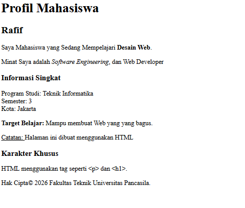

# Dokumentasi Tugas Individu — Pertemuan 1 (Profil Mahasiswa)

## Identitas Mahasiswa

```Mahasiswa
Nama: Muhammad Rafif Akbar
NPM: 4525210125
Mata Kuliah: Prak. Desain Web
```

## Penjelasan

Halaman web ini adalah latihan dasar HTML yang menampilkan profil singkat seorang mahasiswa Teknik Informatika bernama Rafif. Proyek ini mendemonstrasikan penggunaan elemen-elemen fundamental HTML, meliputi:

- **Struktur Dokumen & Heading**: Menggunakan tag `<!DOCTYPE html>`, `<html>`, `<head>`, `<body>`, serta hierarki heading (`<h1>` hingga `<h3>`) untuk judul dan subjudul.
- **Teks & Pemformatan**: Menerapkan paragraf (`<p>`) serta penekanan teks menggunakan tag `<strong>`, `<em>`, `<b>`, dan `<u>`.
- **Line Break**: Menggunakan tag `<br />` untuk pemenggalan baris dalam informasi singkat.
- **Karakter Khusus (Entities)**: Menggunakan entitas HTML seperti `&lt;`, `&gt;` untuk menampilkan simbol tag, dan `&copy;` untuk simbol hak cipta.

## Kesimpulan

Praktikum ini berhasil mengimplementasikan struktur dasar dokumen HTML dan penggunaan tag-tag pemformatan teks standar. Halaman ini berfungsi sebagai pengenalan awal dalam menyusun halaman web yang rapi, informatif, dan sesuai kaidah dasar _Web Development_.

## Hasil


