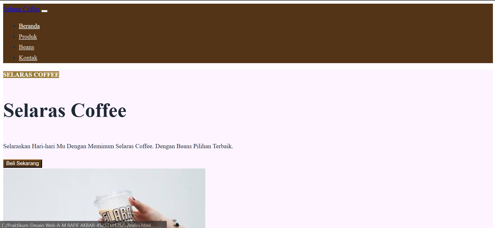
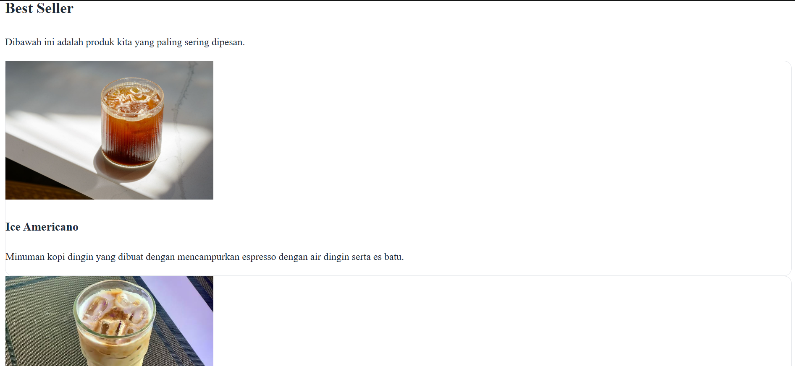
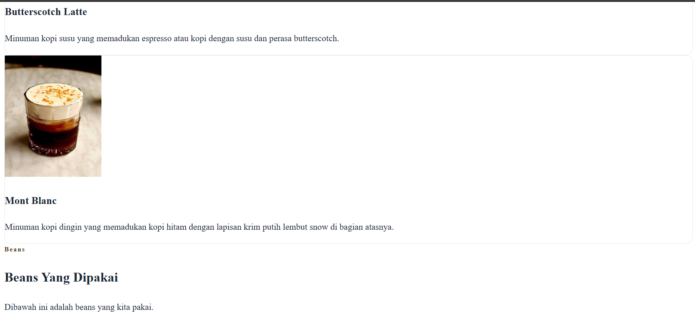
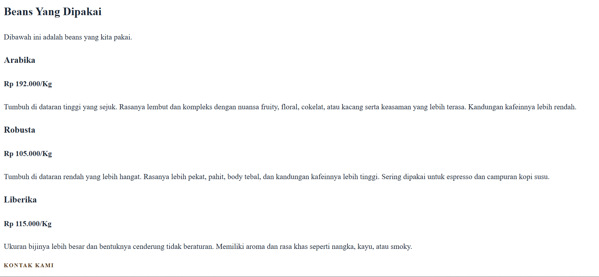
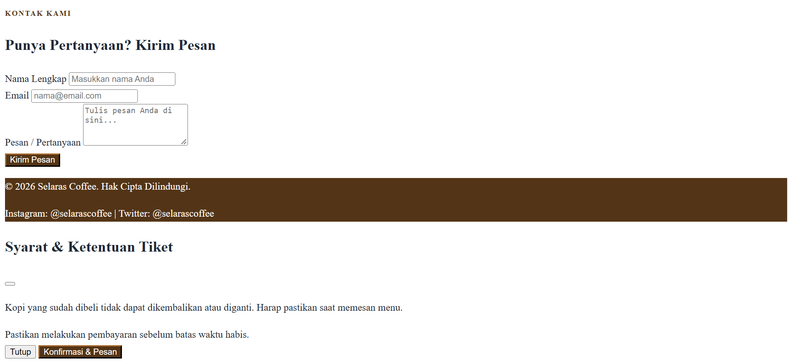
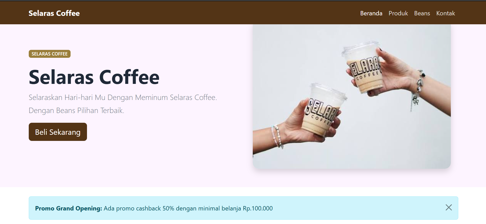
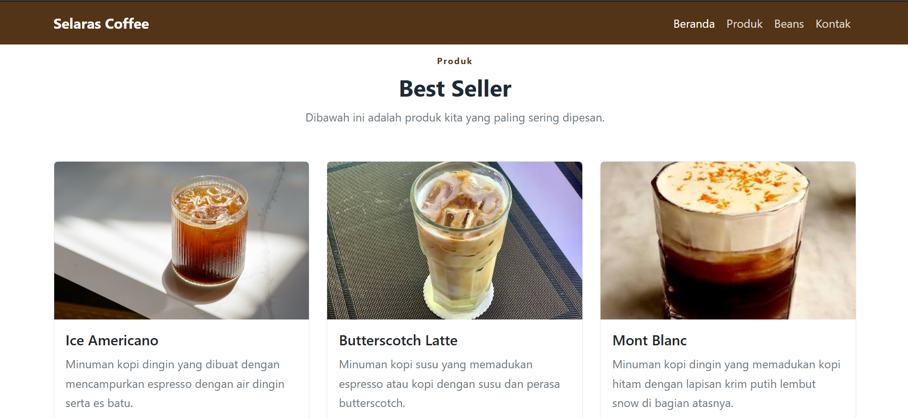
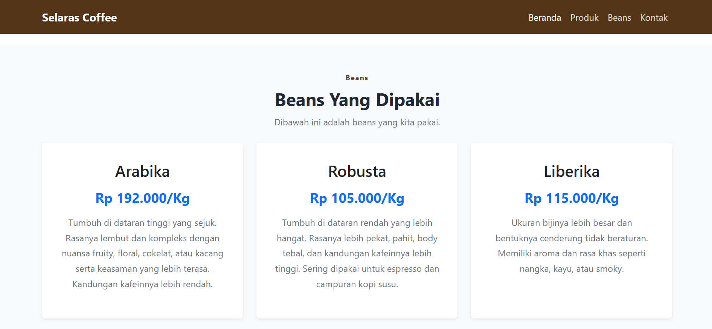
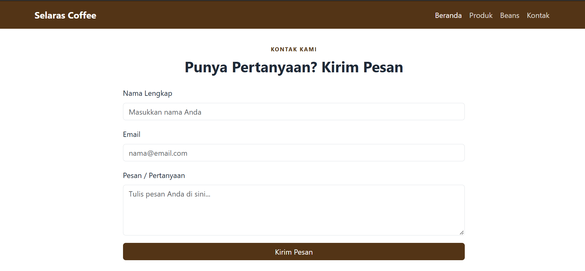
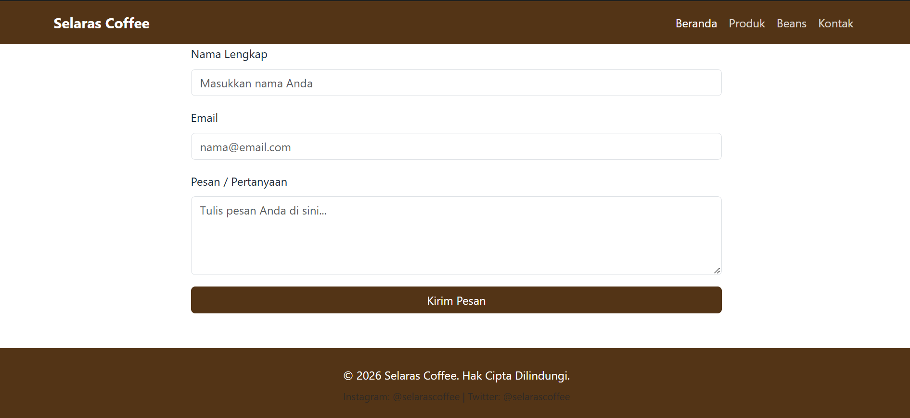

# Dokumentasi Tugas Individu — Pertemuan 10 (BOOTSTRAP LANJUTAN DAN MODIFIKASI CSS)

## Identitas Mahasiswa

```Mahasiswa
Nama: Muhammad Rafif Akbar
NPM: 4525210125
Mata Kuliah: Prak. Desain Web
```

## Sebelum






## Sesudah 






## Penjelasan
Proyek ini adalah halaman frontend sederhana untuk UMKM “Selaras Coffee” membutuhkan website yang dapat dipresentasikan kepada calon pelanggan dan mitra. Website ini memiliki navbar responsif, hero, produk, notifikasi promo, modal, form kontak, dan footer. 

## Fitur
1. Menampilkan produk produk yang best seller dan ada penjelasan tiap produknya.

2. Menampilkan produk beans yang yang dipaki dan ada penjelasan tiap beansnya.

3. Ada notifikasi promo untuk pelanggan dan notifikasi itu bisa  dihapus.
 
 4. Ada form kontak untuk memberikan ulasan atau pesan.

 5. Ada tombol untuk memesan kopinya.