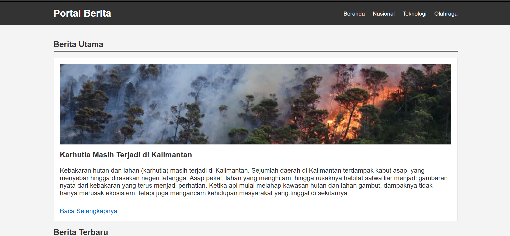
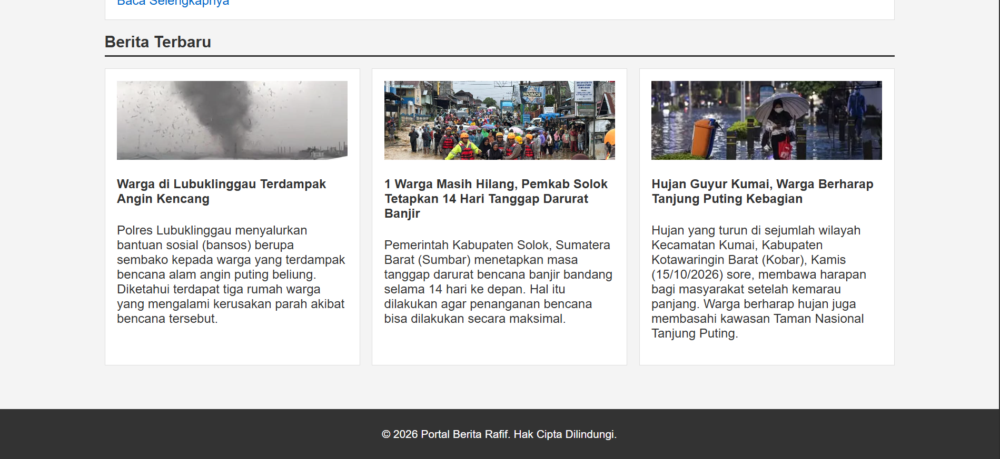

# Dokumentasi Tugas Individu — Pertemuan 5 (Wireframe)

## Identitas Mahasiswa
```Mahasiswa
Nama: Muhammad Rafif Akbar
NPM: 4525210125
Mata Kuliah: Prak. Desain Web
```

## Penjelasan
Proyek ini merupakan halaman web Portal Berita sederhana yang dirancang menggunakan kombinasi HTML dan CSS untuk menghasilkan tampilan portal berita yang rapi, terstruktur, dan mudah dibaca.

Pada bagian HTML, struktur halaman terbagi menjadi tiga komponen utama, yaitu bagian header, main, dan footer. Bagian header berisi logo situs dan menu navigasi utama (Beranda, Nasional, Teknologi, dan Olahraga). Bagian main bertindak sebagai wadah konten utama yang terbagi dua Berita Utama (featured news) yang menampilkan berita paling menonjol lengkap dengan gambar besar, narasi singkat, dan tautan "Baca Selengkapnya" serta Berita Terbaru (latest news) yang menyajikan daftar artikel berita tambahan menggunakan format kartu ringkas. Di bagian paling bawah, footer memuat informasi hak cipta situs.

Dari sisi styling CSS, tata letak dirancang agar bersih dan nyaman dilihat menggunakan kombinasi font Arial, warna latar abu-abu terang (#f4f4f4), serta pembatas .container berukuran maksimal 1000px agar konten selalu berada tepat di tengah layar. CSS ini memanfaatkan teknik Flexbox pada header dan kisi berita (.news-grid), sehingga elemen-elemen web dapat tersusun secara otomatis, rapi, dan fleksibel. Selain itu, penggunaan properti object-fit: cover pada seluruh gambar memastikan setiap visual dapat terisi sempurna di dalam wadahnya tanpa mengalami distorsi atau perubahan rasio yang merusak tampilan.

## Hasil




## Kesimpulan

Proyek Portal Berita ini berhasil mengimplementasikan konsep dasar tata letak web modern menggunakan HTML dan CSS. Dengan memanfaatkan teknik Flexbox dan pengaturan responsivitas sederhana, halaman web mampu menyajikan konten berita yang terstruktur, menarik secara visual, serta nyaman diakses di berbagai ukuran layar. Kode yang bersih dan rapi ini menjadi fondasi yang sangat baik untuk dikembangkan lebih lanjut, seperti penambahan fitur interaktif dengan JavaScript maupun pengintegrasian dengan database berita di masa mendatang.