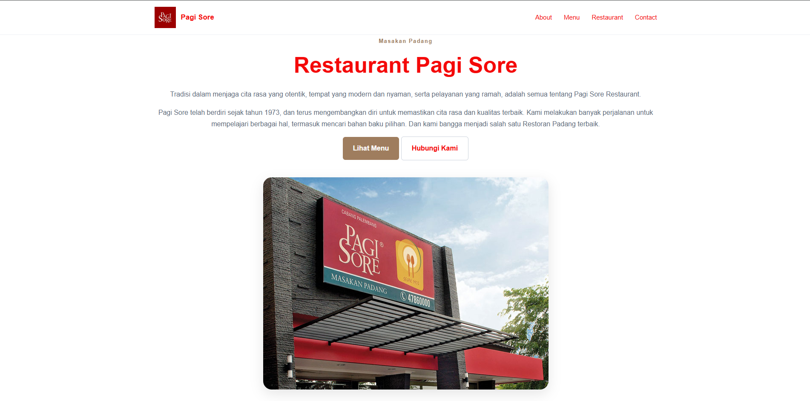
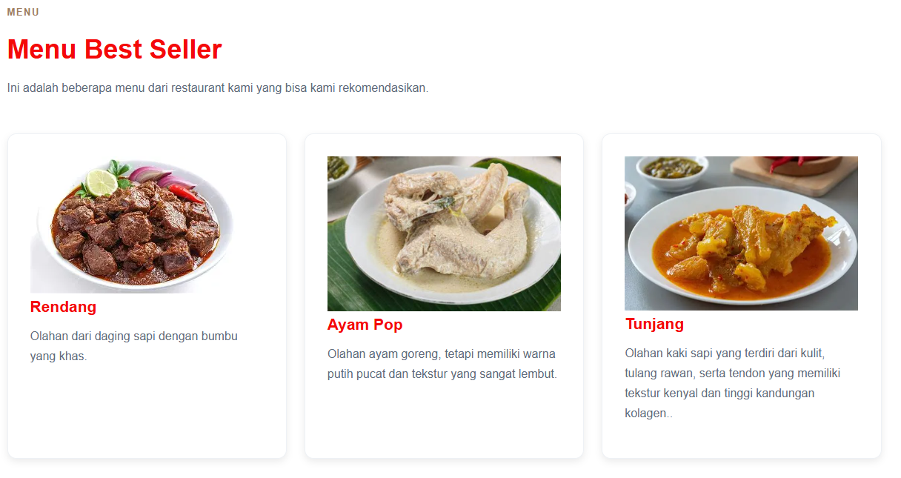
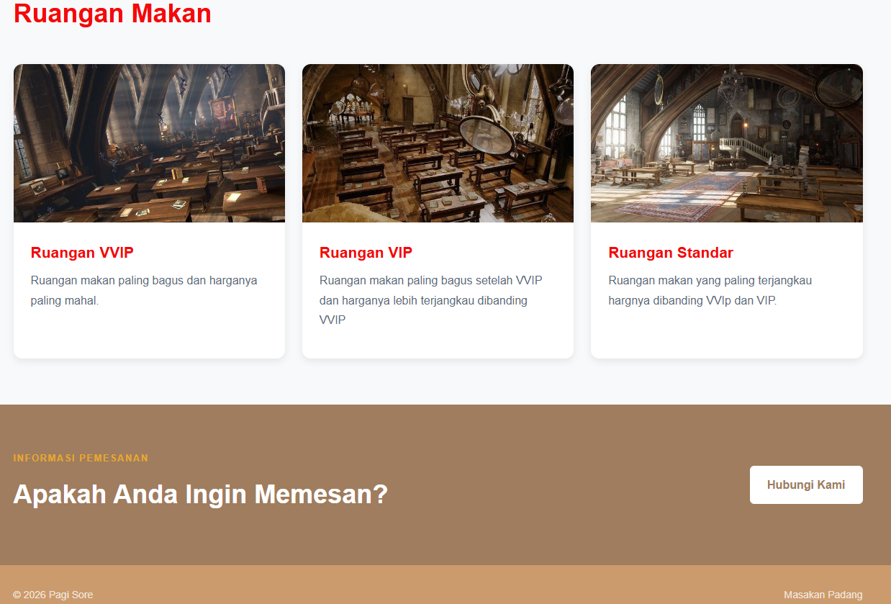

# Dokumentasi Tugas Individu — Pertemuan 6 (Mockup - Visual Hierarchy - Warna - Tipografi)

## Identitas Mahasiswa

```Mahasiswa
Nama: Muhammad Rafif Akbar
NPM: 4525210125
Mata Kuliah: Prak. Desain Web
```

# Website Profil Restoran Pagi Sore

Repositori ini berisi kode sumber untuk halaman web profil **Restoran Pagi Sore** (Masakan Padang), yang dibangun menggunakan **HTML5** dan **CSS3**. Desain web ini mengusung konsep modern, responsif, dan elegan untuk menyajikan informasi terkait sejarah, menu unggulan, fasilitas ruangan, serta kontak pemesanan kepada pengunjung.

---

## Penjelasan Struktur & Komponen Website

### 1. **index.html**

Website ini dibagi menjadi beberapa bagian utama (sections) yang semantik:

- **Header & Navigasi (`<header>`):** Berisi logo restoran, nama brand (**Pagi Sore**), serta menu navigasi cepat (`About`, `Menu`, `Restaurant`, `Contact`) yang menggunakan teknik _sticky navigation_ agar tetap berada di atas saat halaman digulir.
- **Hero Section (`<main>` -> `#about`):** Bagian utama penyambut pengunjung. Berisi label, judul utama, deskripsi singkat mengenai sejarah restoran sejak tahun 1973, serta tombol aksi cepat (_Call to Action_).
- **Menu Best Seller (`#menu`):** Menampilkan daftar menu andalan restoran dalam bentuk grid kartu interaktif, seperti **Rendang**, **Ayam Pop**, dan **Tunjang**.
- **Ruangan Makan / Fasilitas (`#restaurant`):** Menampilkan informasi pilihan ruangan makan bagi pengunjung, mulai dari **Ruangan VVIP**, **Ruangan VIP**, hingga **Ruangan Standar**.
- **Call to Action & Kontak (`#cta`):** Bagian ajakan bagi pengunjung yang ingin melakukan pemesanan dengan tombol email langsung.
- **Footer (`<footer>`):** Berisi informasi hak cipta (_copyright_) dan keterangan singkat restoran.

---

### 2. **style.css**

Desain antarmuka dirancang menggunakan pendekatan modern dengan fitur-fitur CSS berikut:

- **Design Tokens (`:root`):** Menggunakan variabel CSS untuk memudahkan pengelolaan warna utama (`--primary`, `--primary-dark`), warna aksen, warna netral, ukuran _border-radius_, bayangan (_box-shadow_), dan jarak (_spacing_).
- **Reset & Typography:** Mengatur ulang margin bawaan browser dan menggunakan _font-family_ Arial/Helvetica yang bersih serta _scroll-behavior: smooth_ untuk navigasi halaman yang halus.
- **Layout Modern (Flexbox & CSS Grid):**
  - Menggunakan **Flexbox** untuk merapikan struktur _navbar_, tata letak _hero_, dan _footer_.
  - Menggunakan **CSS Grid** (`grid-template-columns: repeat(3, 1fr)`) untuk menampilkan kartu menu dan fasilitas secara terstruktur dalam 3 kolom pada layar besar.
- **Responsivitas (Media Queries):**
  - Dirancang agar adaptif terhadap berbagai ukuran layar (tablet dan _smartphone_). Pada layar berukuran di bawah 900px dan 600px, tata letak grid berubah secara otomatis menjadi 2 kolom atau 1 kolom tunggal demi kenyamanan pengguna _mobile_.

---

## Kesimpulan

Website Restoran Pagi Sore ini merupakan contoh penerapan desain antarmuka web (_User Interface_) yang bersih, terstruktur, dan ramah pengguna (_user-friendly_). Dengan memanfaatkan fitur modern CSS seperti _CSS Variables_, _Grid_, _Flexbox_, serta desain yang _responsive_, website ini mampu memberikan pengalaman visual yang menarik dan nyaman diakses baik melalui komputer, tablet, maupun ponsel pintar.

## Output



