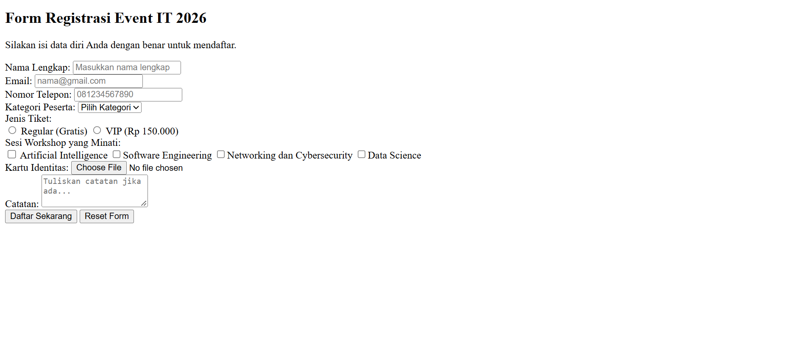
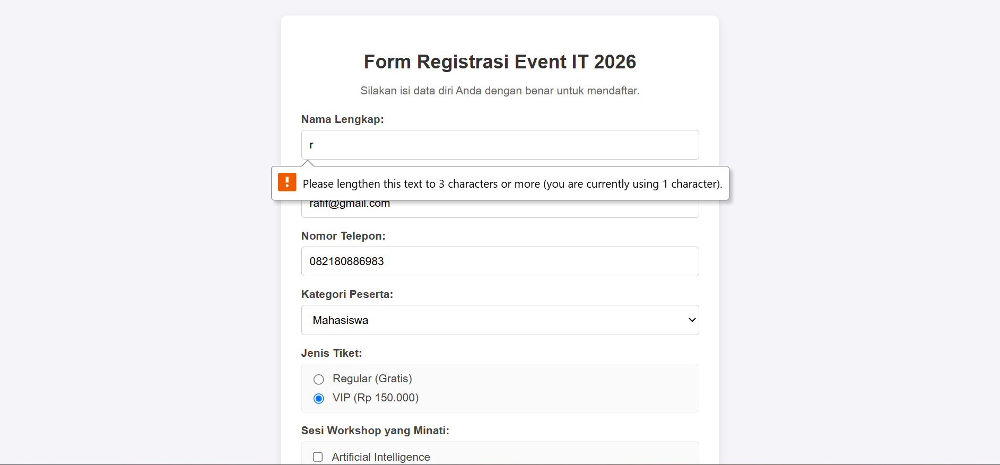
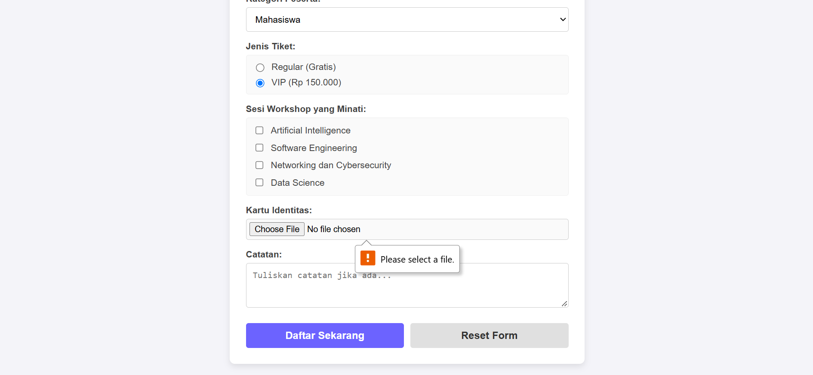

# Dokumentasi Tugas Individu — Pertemuan 7 (INPUT DAN PENGIRIMAN DATA)

## Identitas Mahasiswa

```Mahasiswa
Nama: Muhammad Rafif Akbar
NPM: 4525210125
Mata Kuliah: Prak. Desain Web
```

## Sebelum


## Sesudah 



## Penjelasan
Proyek ini berisi implementasi form registrasi event IT 2026 yang menggunakan kontrol HTML5 dasar seperti input (text, email, tel, file, radio, checkbox), select, textarea, serta tombol submit dan reset. Form ini menerapkan aturan validasi native HTML5 untuk memvalidasi kelengkapan serta keabsahan data peserta.

 Penjelasan Perubahan, Masalah, dan Solusi

Masalah 1: Format Isian Telepon Tidak Sesuai Standar
Deskripsi: Pengguna sering memasukkan nomor telepon dengan jumlah digit acak atau tidak diawali kode area Indonesia.
Solusi: Menggunakan atribut pattern="^08[0-9]{8,11}$" untuk memastikan nomor selalu diawali 08 dan memiliki panjang 10–13 digit angka.

Masalah 2: Potensi Pengunggahan File Eksekusi Berbahaya
Deskripsi: Input tipe file secara standar mengizinkan pengguna memilih semua tipe berkas.
Solusi: Menambahkan atribut accept=".jpg, .jpeg, .png, .pdf" untuk membatasi opsi format berkas pada dialog pengunggahan.

Masalah 3: Pengosongan Form Secara Tidak Sengaja
Deskripsi: Adanya tombol <button type="reset"> dapat menyebabkan pengguna menghapus seluruh isian form secara tidak sengaja.
Solusi: Memberikan styling visual yang membedakan warna tombol submit dan reset agar pengguna lebih berhati-hati saat menekan tombol.