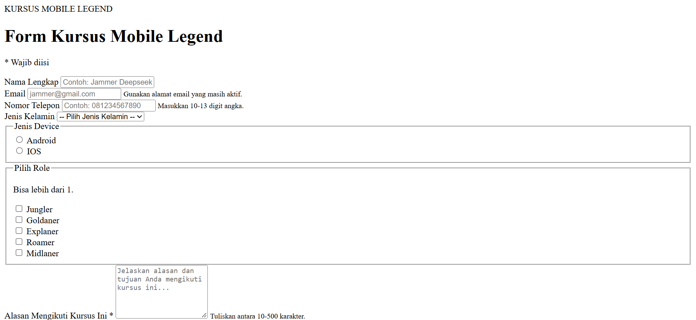
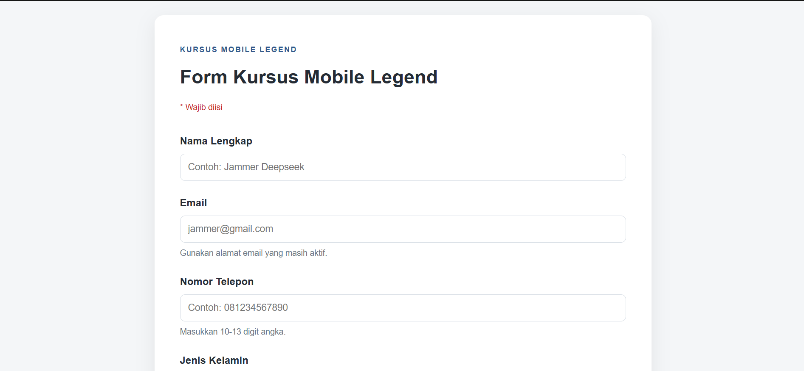
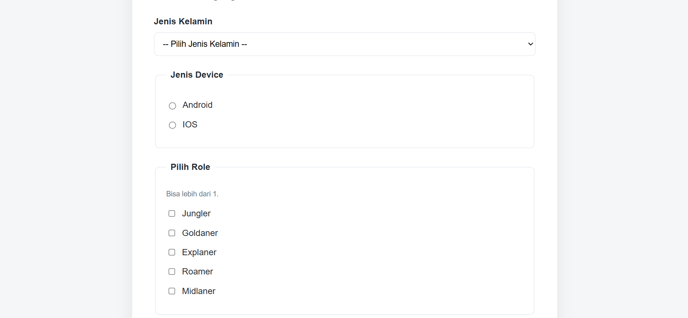
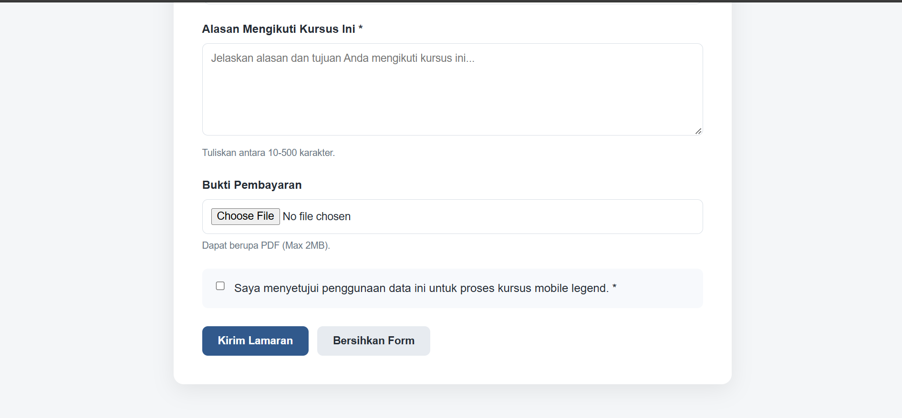

# Dokumentasi Tugas Individu — Pertemuan 8 (PILIHAN, UPLOAD, TEXT AREA, DAN VALIDASI HTML)

## Identitas Mahasiswa

```Mahasiswa
Nama: Muhammad Rafif Akbar
NPM: 4525210125
Mata Kuliah: Prak. Desain Web
```

## Sebelum


## Sesudah 




## Penjelasan
Berikut penjelasan isi form pada index.html. Form menggunakan method="post" dan enctype="multipart/form-data" karena ada pengiriman file.

1. Nama Lengkap input type="text" dengan minlength="3" dan maxlength="60" untuk membatasi panjang nama, serta required agar wajib diisi.

2. Email input type="email" sehingga browser otomatis memeriksa format email. Atribut required membuatnya wajib diisi, dan "small" memberi petunjuk penggunaan.

3. Nomor Telepon pattern="[0-9]{10,13}" hanya menerima angka sebanyak 10-13 digit, diperkuat dengan minlength, maxlength, dan required.

4. Jenis Kelamin "select" berisi opsi Laki-Laki dan Perempuan. Opsi pertama bernilai kosong, sehingga bersama required pengguna harus memilih salah satu.

5. Jenis Device Dua pilihan, yaitu Android dan iOS, dikelompokkan dengan <"fieldset" dan "legend". 

6. Pilih Role Lima checkbox (Jungler, Goldaner, Explaner, Roamer, Midlaner) dengan name="role[]", sehingga pengguna bisa memilih lebih dari satu dan datanya dikirim sebagai array.

7. Alasan Mengikuti Kursus "textarea" 6 baris dengan minlength="10", maxlength="500", dan required untuk membatasi isian 10-500 karakter.

8. Bukti Pembayaran input type="file" dengan accept="pdf" agar hanya file PDFvyang bisa dipilih.

9. Persetujuan Checkbox dengan required, sehingga form tidak bisa dikirim sebelum pengguna menyetujui penggunaan data.

10. Tombol type="submit" untuk mengirim form dan type="reset" untuk mengosongkan semua isian. Keduanya dibedakan tampilannya dengan class btn-primary dan btn-secondary.