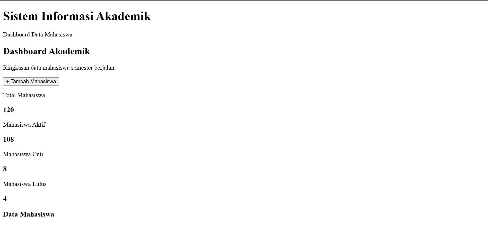
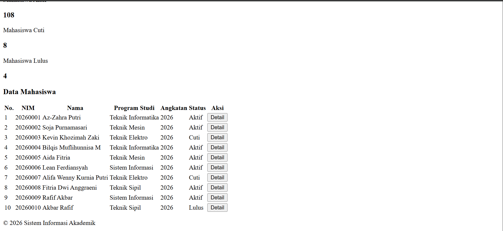
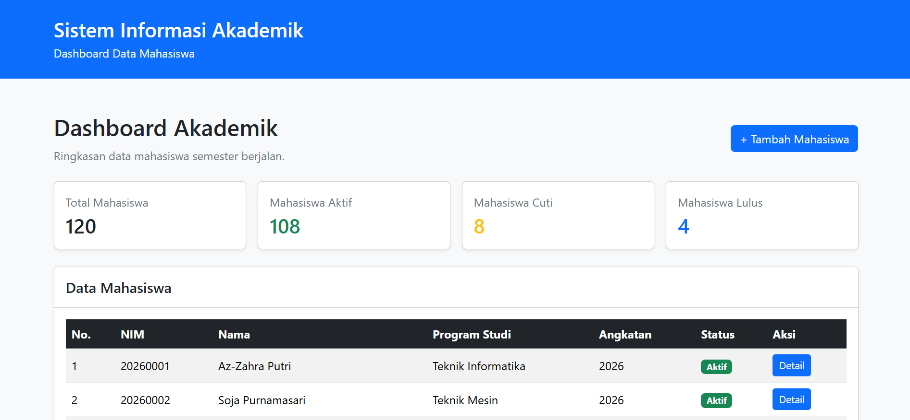
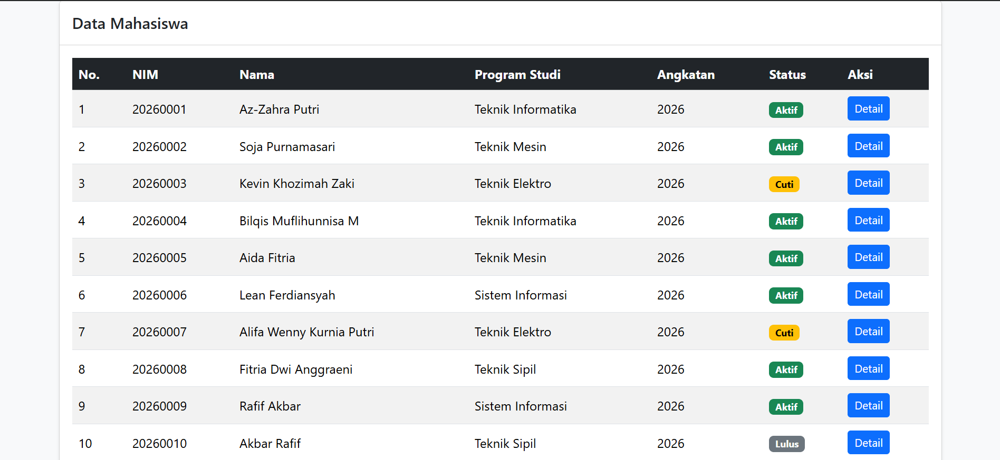

# Dokumentasi Tugas Individu — Pertemuan 9 (BOOTSTRAP FRAMEWORK GRID SYSTEM DAN TABLE RESPONSIF)

## Identitas Mahasiswa

```Mahasiswa
Nama: Muhammad Rafif Akbar
NPM: 4525210125
Mata Kuliah: Prak. Desain Web
```

## Sebelum




## Sesudah 



## Penjelasan
Proyek ini adalah halaman antarmuka (frontend) sederhana untuk Sistem Informasi Akademik yang dirancang menggunakan framework Bootstrap 5.3.8. Halaman ini menampilkan ringkasan data statistik mahasiswa serta tabel daftar mahasiswa aktif, cuti, dan lulus secara responsif.

## Fitur
1. Menggunakan sistem grid fleksibel (row align-items-center) untuk menyelaraskan judul halaman dengan tombol aksi "+ Tambah Mahasiswa" di sebelah kanan pada layar medium ke atas (col-md-4 text-md-end).

2. Menggunakan grid responsif Bootstrap:
col-12 (Tampil 1 kolom penuh pada layar HP).
col-md-6 (Tampil 2 kolom pada layar Tablet).
col-lg-3 (Tampil 4 kolom berdampingan pada layar Laptop/Desktop).

3. Dibungkus dengan kelas table-responsive agar tabel tetap rapi dan dapat digeser secara horizontal pada layar berukuran kecil.